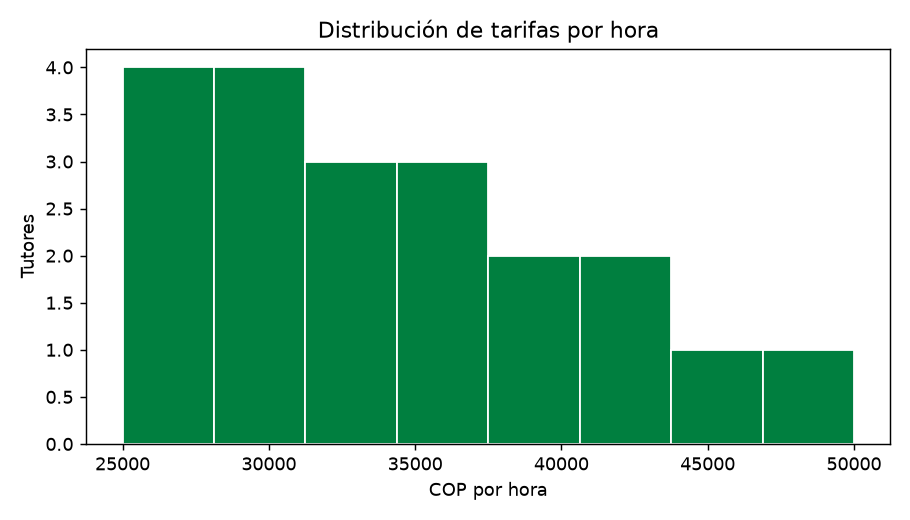
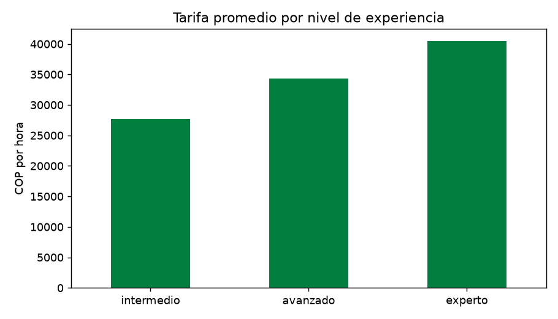
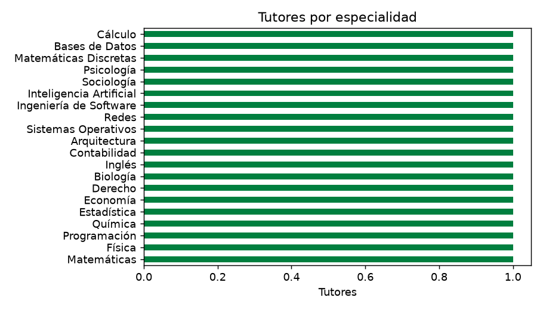
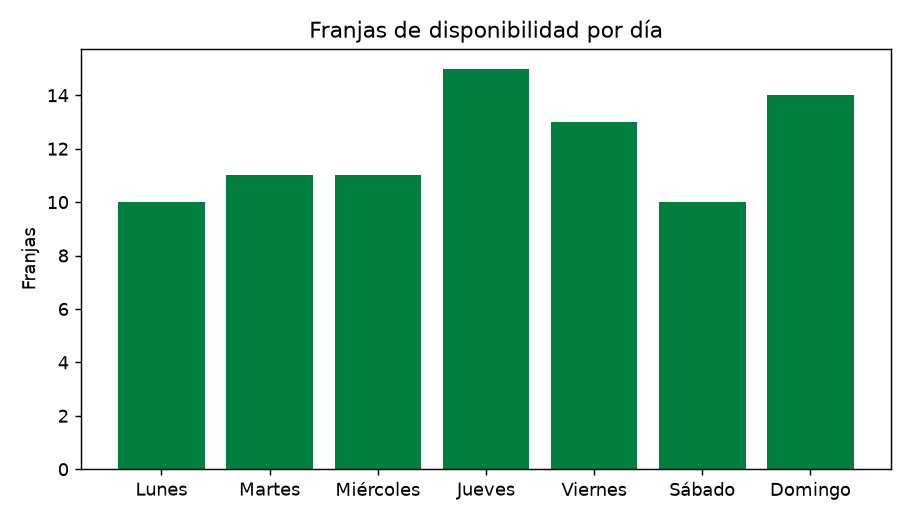
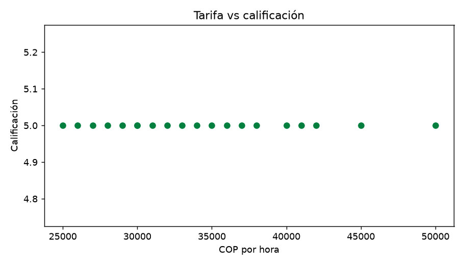
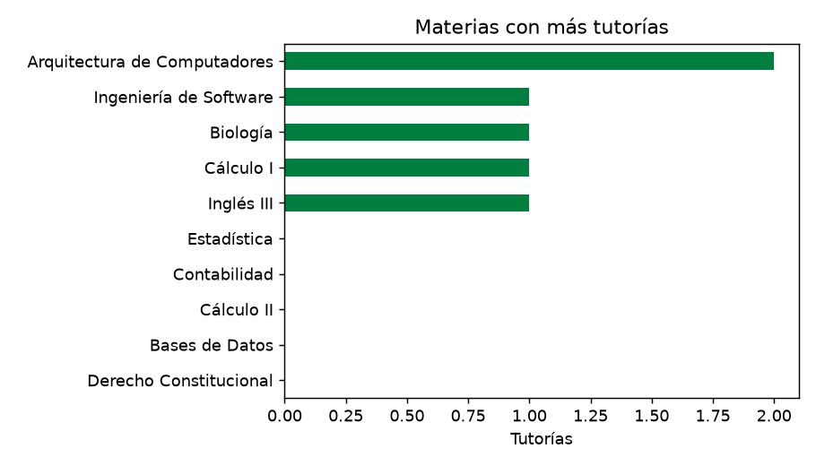

# Análisis exploratorio de datos — TutoUdec

Fuente: `http://4.206.201.129/api` · 20 tutores, 25 materias, 84 franjas de disponibilidad.

## Hallazgos
- Tarifa promedio: **$34,450 COP/h** (mín $25,000, máx $50,000).
- Calificación promedio de los tutores: **5.00**.
- Correlación tarifa–calificación: no calculable (todas las calificaciones son iguales; aún no hay reseñas reales).
- Especialidad con más tutores: **Matemáticas** (1).
- Día con más disponibilidad: **Jueves**; con menos: **Lunes**.
- Tutor con más horas ofrecidas por semana: **evargas** (14 h).
- Materias sin tutorías registradas: **20** de 25.

## Tarifa por nivel
| nivel_experiencia | count | mean | min | max |
|---|---|---|---|---|
| intermedio | 6.0 | 27667.0 | 25000.0 | 31000.0 |
| avanzado | 7.0 | 34286.0 | 30000.0 | 38000.0 |
| experto | 7.0 | 40429.0 | 30000.0 | 50000.0 |

## Calificación promedio por nivel
| nivel_experiencia | calificacion |
|---|---|
| intermedio | 5.0 |
| avanzado | 5.0 |
| experto | 5.0 |

## Gráficas

_Nota: los datos actuales son de prueba (seed_data); las conclusiones deben releerse con datos reales._